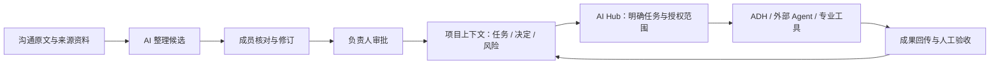
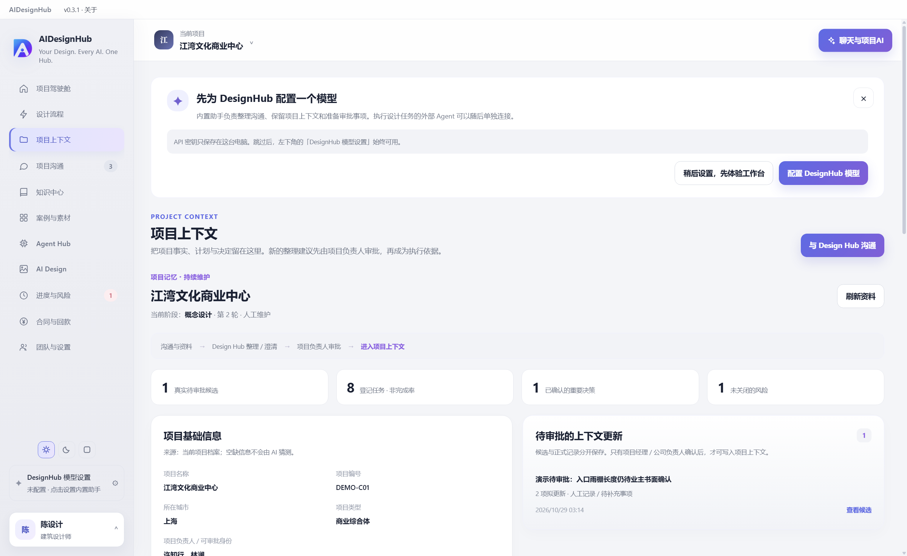
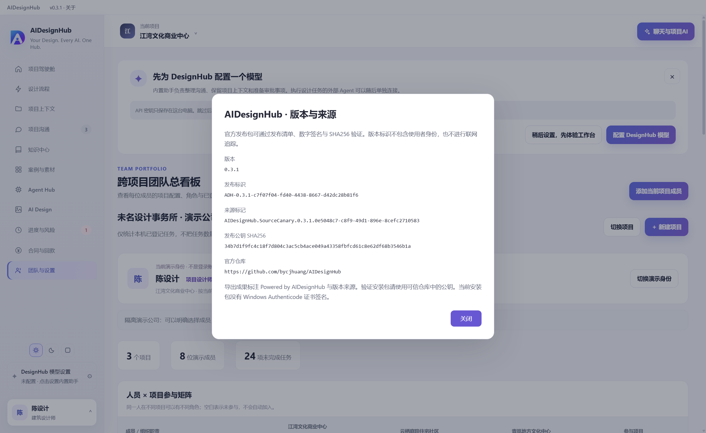

# AI Design Hub · 设计项目智能协作工作台

<p align="center"></p>

**Your Design. Every AI. One Hub.｜你的设计，万千 AI，一个枢纽。**

AI Design Hub 面向建筑、室内、景观等设计团队，把项目上下文、人员与任务、桌面 Agent、专业软件、知识与创作资产连接在一个 Windows 本地工作台中。让 AI 理解「这个项目现在做到哪里、哪些事情已经确认、谁负责、有什么限制」，再协助组织工作和完成创作，是这个项目的出发点。

**人主导，AI 辅助记录，不替代审批。** 项目的决定权、责任和成果验收始终由人掌握。

当前源码版本 **0.3.2**，处于持续迭代的可用原型阶段。自有整合代码按 **AGPL-3.0-only** 发布，第三方代码保留原许可；完整功能范围以 [当前状态](docs/CURRENT-STATE.md) 为准。

**[下载 0.3.2 Windows x64 安装包与对应源码](https://github.com/bycjhuang/AIDesignHub-OpenSource/releases/tag/v0.3.2)**。安装器约 **630.7 MiB**，附源码 ZIP、Ed25519 签名清单及验签工具；见 [本版发布验收](docs/release-0.3.2-2026-10-29.md) 与 [开源审核记录](docs/open-source-audit-2026-10-29.md)。旧版 0.3.1 的原有签名与验收记录保留。

开源源码与官方安装包见 [AIDesignHub-OpenSource](https://github.com/bycjhuang/AIDesignHub-OpenSource)。许可范围见 [LICENSE](LICENSE)、[COPYRIGHT.md](COPYRIGHT.md) 与 [第三方声明](THIRD-PARTY-NOTICES.md)。AGPL 允许遵守协议的商业使用与衍生发行，不保证阻止合规的改名销售。用户项目、知识资料和模型密钥不随源码公开，用户输出也不会仅因使用本软件而自动受 AGPL 约束。

## 为什么做：设计公司遇到的五个问题

| 现场的问题 | 我们希望建立的能力 | 当前落点 |
| --- | --- | --- |
| **项目上下文集中在负责人脑中。** 沟通、变更、约定和风险分散在不同地方，交接时要反复解释。 | 项目有可持续维护的记忆，团队和 AI 有共同的事实依据。 | 项目上下文、原文来源、确认决定、任务、风险与审批回执。 |
| **AI 与专业软件的接口各自为战。** 每个工具单独接入，维护成本高，经验难复用。 | 在同一工作台维护 MCP、ACP、CLI 等连接方式。 | 统一 Agent 网关、协议适配、专业软件工具的搜索与按需激活。 |
| **桌面 Agent 越来越多，组织工作却越来越分散。** 同一个项目要在多个客户端反复交代。 | 用项目上下文组织多个 Agent，统一下发任务、收取成果、人工验收。 | AI Hub 对话、执行器选择、多 Agent 分任务与运行记录。 |
| **经验留在个人电脑和单个项目中。** Skill、提示词、案例、知识与视觉风格难沉淀为团队能力。 | 把个人实践积累成可复用的组织资产。 | 本机知识中心、案例库、技能中心、项目风格套件；已实现技能说明快照的局域网只读共享。 |
| **企业的 AI 实践缺少持续建设的产品载体。** 零散演示难以形成自己的方法和科技品牌。 | 用可演示、可维护的工作台承载企业的管理方法与创作流程。 | 项目管理与 AIGC 创作的共同入口；公司级部署和认证能力继续建设。 |

## 核心理念：先有可信的项目事实，再让 AI 参与工作

### 项目上下文是一项需要维护的资产

「项目上下文」包括项目档案、当前阶段、任务、已经确认的沟通与决定、风险及来源资料。重要的不是把文件全部塞给模型，而是让人与 AI 清楚区分：哪些是已确认事实，哪些仍是建议，哪些需要负责人判断。

例如，会议上提出「将主入口雨棚调整为金属构造」，项目助手先保存原文，整理成待核对候选；成员修订后，由当前项目的项目经理或公司负责人审批，才成为正式决定。后续交给 Agent 的任务据此组织上下文，避免每次重新解释，也避免把尚未确认的意见当作执行依据。



这里描述的是项目助手与派单的工作原则。旧业务入口仍存在人工直接登记路径；当前角色权限也不等于完整的企业账号认证。



上图来自全新隔离的演示公司，项目与成员为虚构样例，模型未配置，不含维护者的真实项目资料或密钥。

### 人负责判断，Agent 负责有依据地执行

阶段、轮次、责任人与设计判断由人维护。登记任务数和任务状态只表达已录入的信息，不据此推算「设计完成度」。AI 可以整理、检索、提出建议和调用获准工具；模型回复、工具发现成功或客户端被检测到，都不能单独证明任务完成。成果需要回传并由人验收。

### 统一入口，尊重现有工具与工作方式

工作台围绕项目组织桌面上的 AI 和专业软件，也保留外部 Agent 自己的账号、模型与权限边界。它可以与飞书等现有沟通、审批系统并存；当前没有把飞书集成描述为已交付能力。长期目标是把经确认的项目上下文与执行能力连接起来，减少跨工具交代工作的成本。

### 从一次成果，积累为团队的方法

案例研究留下来源、图文和分析；知识检索留下可回查的依据；技能保存可重复使用的操作方法；风格套件保存颜色、字体、Logo 和参考图约束。这些共同构成组织能力的积累方向。当前各类资产的共享范围不同，尚不是一个已部署的企业云资产平台。

## 两个主入口，同一个项目

| Agent Hub｜组织与协作 | AI Design｜画布与创作 |
| --- | --- |
| 以 AI Hub 对话为中心，使用内置 ADH Agent，或明确选择外部执行器；关联项目任务、知识与案例。 | 基于 Loomic 与 Excalidraw 的沉浸式画布，支持图片生成、已有图片编辑、画布 Agent 与项目风格套件。 |
| 在协作中心配置连接、检测本机 Agent、管理授权，查看派单进度与成果。 | 使用 Hub 统一配置的文本、图片和视频模型；成果保存在本机，并按项目隔离。 |

两侧共用项目身份与模型设置。Agent Hub 提供组织工作的入口，AI Design 承接视觉创作；项目驾驶舱、知识中心和案例库为两侧提供依据。

## 现在可以做什么

| 模块 | 已有能力 | 使用边界 |
| --- | --- | --- |
| **项目管理与上下文** | 八阶段流程、角色视角、任务、决定、风险、合同与回款登记；项目助手的原文、候选、核对、负责人审批和回执。 | 阶段由人维护；合同与回款是登记功能；成员切换不等于企业身份认证。 |
| **ADH 与专业软件** | 内置 DeepSeek Harness `0.2.1-rc.2`；14 类专业软件 MCP，先搜索再激活工具；技能列表与本地语音输入入口。 | 历史本机握手检查覆盖 770 个工具，不等于 770 项操作均已验收；真实操作需要安装目标软件和相应桥接插件。 |
| **外部 Agent 协作** | 支持 MCP / ACP / CLI 等接入；从 AI Hub 派单、冻结上下文、回传成果并人工验收；可一次 @ 多个 Agent 分任务。 | 自动发现和配对不等于模型可用；不同执行器的登录和端到端验证范围各异。 |
| **本地知识中心** | 文件与文件夹导入、语义与全文检索、Office / PDF 解析、扫描资料 OCR、带出处问答、Word / Excel / PPT 导出。 | 解析与检索在本机；问答按用户配置调用模型，所用片段可能发送给模型服务；OCR 与答案需核对。 |
| **案例与研究成果** | 公开链接采集、本地图文阅读、高清图片筛选和归档；结合当前项目筛选对标案例，交给 ADH 分析并制作 PPT。 | 保留来源和待核对字段；不能保证任意网站都可采集。支持简报 / 杂志两种 PPT 风格，每案例默认 1 页、最多 3 页。 |
| **AI Design 画布** | 图片生成与编辑、Agent 读写画布、风格约束自动加入提示；生成回执可在刷新后恢复，避免重复提交。 | 需要自配模型接口；失败或不确定状态会明确提示；视频接口已接入，但真实付费视频生成尚未完成本轮验收。 |
| **可复用资产** | 多套风格套件、本机技能与团队共享技能；按成员身份分享、更新和撤回技能说明快照。 | 局域网技能服务为只读分享，不同步项目、知识库、消息或模型配置；统一云端资产中心仍是演进方向。 |

14 类专业软件涵盖 Blender、3ds Max、Revit、Rhino、SketchUp、ArchiCAD、AutoCAD、Photoshop、Illustrator、InDesign、Lightroom、Premiere、After Effects、Cinema 4D。具体接入与验证范围见 [专业 MCP 说明](docs/harness-mcp-upgrade-2026-10-26.md) 和 [Agent 兼容说明](docs/agent-compatibility.md)。

一条典型流程是：选择项目 → 确认当前阶段与限制 → 导入任务书和会议原文 → 核对并审批上下文 → 在 AI Hub 交代案例研究或专业工具任务 → 收取成果、人工验收 → 把有用的方法保存为技能、案例或风格套件，供下一次工作使用。

## 三项目、八成员演示公司

双击 `启动-3项目8人演示.cmd`，或运行 `node scripts/start.cjs --demo-company`。演示公司使用单独的 `demo-company-v1` 业务数据目录，不覆盖原来的项目库或复制真实文件。正常与演示模式共用同一套程序，以及本机的模型设置、受支持执行器配对；项目授权和执行结果不会因此跨库复制。

打开后默认进入团队看板。点击左下角姓名卡，选择一位成员，再选择要进入的项目；切换的是该成员实际项目身份，不是看板显示视角。当前身份会联动任务、上下文、聊天隔离及负责人审批权限。

预置商业概念、住宅深化、公共文化前研三个项目，八位虚构成员分别承担公司负责人、项目经理、设计总监、建筑设计、BIM、景观与室内、校审和经营财务。每个项目都有任务、风险、背景决定与待审批候选。普通设计人员只能查看候选，项目经理或公司负责人可以在演示库内实际审批，形成回执。

演示库练习会保存，重启不会重置。聊天仍是前端演示、不联网投递；公司演示身份不等于企业账号认证。原始项目仍通过原启动入口打开。详见 [演示公司使用说明](docs/demo-company.md)。

## 本机模型与自动连接助手

左下角常驻「DesignHub 模型设置」，统一管理「对话与推理 / 图片生成 / 视频生成」。支持多配置、默认模型切换，以及 DeepSeek、百炼、OpenAI 兼容与 APIMart 等接口。首次使用需填写自己的 API Key，也可先跳过体验项目管理；安装包不预装维护者的账号或密钥。

模型配置加密保存在用户数据下的 `device-settings-v1/model-private/`。正常与演示项目共用，不会随身份或项目切换丢失，也不进入 Git。旧工作区存在唯一有效配置时迁移加密副本；有冲突不覆盖。没有旧密钥文件时仍需在设置页填写，程序不会从第三方 Agent 抽取密钥。

内置模型只收到产品、版本与接口能力元数据，用来排序配对候选；失败时回退到固定适配规则。连接助手自动处理受支持安装目录、独立 Python 环境、兼容备用入口；不执行模型生成的任意命令，不修改外部账号或安全设置。自动配对不会派发项目任务。ChatGPT/Codex、ZCode 等桌面安装单独识别，客户端授权不能伪装成已完成连接。

高级路径、参数与 MCP 项目授权折叠在执行器设置中。详细范围见 [安装发现与配对边界](docs/agent-installation-discovery.md) 和 [本机配置与自动配对](docs/device-setup.md)。

## 安装与启动

Windows 用户可使用本地生成的 **AIDesignHub-Setup-0.3.1.exe**，按向导选择安装位置，然后从桌面或开始菜单启动。安装包携带画布静态资源、ADH Agent、专业 MCP 运行资源及离线知识引擎，不要求首次启动时再下载这些组件。调用在线模型、采集网页及使用外部 Agent 仍需要相应网络与账号。当前安装包尚未签名。

已有本机运行环境可双击 `启动-AI设计工作台原型.cmd`。

全新克隆：需要 Git 和 Node.js **22.12 或更高版本**（建议统一使用 Node.js 24）。在代码目录运行 `npm ci`，再运行 `npm start`。首次安装会从网络下载锁定版本的依赖及 Electron。现有 `.runtime` 会优先复用，不进入 Git；历史离线缓存启动方式仍保留。内部历史包名保持不变，以免迁移用户数据位置。

另一台 Windows 电脑继续开发并打开三项目、八成员演示：

```powershell
git clone https://github.com/bycjhuang/AIDesignHub-OpenSource.git
cd AIDesignHub-OpenSource
npm ci
npm test
npm start -- --demo-company
```

已克隆的电脑，先提交或暂存自己的修改，再运行 `git pull --ff-only`；依赖锁文件有更新时重新运行 `npm ci`。不要通过覆盖目录的方式同步两台电脑的代码。旧私有仓库及其历史与公开源码仓库分开保留。

代码通过 Git 同步；演示场景会在新电脑首次运行时重新生成，但现有电脑的练习进度、真实项目库、附件、模型凭据与外部 Agent 安装不会自动搬过去。这些内容不应提交到 Git；新电脑配置一次本机模型后，使用自动连接助手发现当地安装，不复制旧电脑的绝对路径。

代码仓库不包含真实项目库、密钥、附件、知识索引、运行时或安装包。预置“江湾文化商业中心”包含演示资料；请勿把预置合同金额或风险当成真实业务数据。

### 从源码启用画布

仓库已包含适配后的 Loomic 源码及其 MIT 许可，依赖与构建产物不提交。完成主项目的 `npm ci` 后，继续执行：

```powershell
cd Loomic-main/Loomic-main
corepack pnpm install --frozen-lockfile
cd ../..
npm run build:ai-design
npm start
```

构建脚本使用本机模式，不需要配置 Loomic 云登录、数据库或积分服务。上游云端代码保留，但不是本地安装版的启动前提。

### 制作安装包

打包需要准备 ADH Harness、专业 MCP 和知识引擎三组运行资源，它们体积较大，不在 Git 中。准备位置与知识引擎构建方式见 [打包说明](docs/local-release.md)。

```powershell
npm run audit:release
npm run dist
```

`dist` 会重建画布、复制明确列出的运行资源、过滤用户配置与缓存、扫描安装内容，最后生成 `release/AIDesignHub-Setup-0.3.1.exe`。安装包只分发程序与公开运行资源，使用者在自己的电脑上配置模型和项目。

## 本地数据与隐私边界

- 项目数据库、知识资料副本、索引和聊天附件保存在当前 Windows 用户的应用数据目录；
- 选择的真实项目文件夹只读扫描，不会被工作台改写；
- 知识库、索引和原始资料默认只留在本机；技能局域网分享仅传递所选说明快照；
- 模型密钥使用系统加密，保存在 `device-settings-v1/model-private/`，不进入源码、安装包、项目上下文或业务备份；
- 渲染层没有 Node.js 和任意文件系统权限，系统能力只通过限定接口开放；
- 不连接 BYCJ 网站线上后端，不消耗网站积分；在线模型按使用者自行配置的服务和账号计费。
- **本地保存不等于所有推理都在本地。** 使用内置模型问答、图片 / 视频生成或外部 Agent 时，提示词、所选资料片段及获准引用的图片可能发送到相应模型服务。外部客户端使用自己的账号、费用与工具权限。
- 发布流程检查源码和安装内容中的可识别凭据与用户配置；真实调研产物、个人汇报材料和开发缓存留在本地。自动扫描不能替代发布前对新增资料的人工核对。

## 当前边界与下一步

- **群聊是前端 Demo。** 演示消息只在窗口内存中保留，刷新即清空，不投递、不归档；真实项目助手和审批流程与它分开。见 [Demo 范围](docs/chat-frontend-demo.md)。
- **普通启动已停用旧项目同步。** 保留历史代码与配置；现有技能只读分享不代表项目、消息或知识库已经跨电脑自动同步。
- **企业身份认证、互联网多端服务、跨机自动同步、截图自动理解与安装包签名尚未完成。** 公司级推广仍需要进一步建设与验收。
- **专业软件逐项操作、真实麦克风和付费视频生成需要补充实机验证。** 现有连接记录和自动测试不能替代这些检查。

长期方向是设计公司的项目智能基础设施：项目经验可以持续积累，AI 在明确的上下文与权限中参与组织和创作，负责人始终掌握决定权。

## 技术结构与开发导航

```text
Electron 主进程 electron-main.cjs
  ├─ preload.cjs：白名单 IPC
  ├─ index.html + *-ui.js + app-v2.js：工作台界面
  ├─ backend/：项目持久化、上下文、Agent、模型与知识服务
  └─ Loomic-main/Loomic-main/：适配后的画布源码
```

内部包名 `bycj-design-workbench-prototype` 为保持现有用户数据目录而保留，不随产品名称变更。

| 需要了解什么 | 从这里开始 |
| --- | --- |
| 今天的功能与限制 | [当前状态](docs/CURRENT-STATE.md) |
| 安装包、运行资源与脱敏检查 | [本地发布说明](docs/local-release.md) |
| 项目管理方法与目录模板 | [设计管理规则包](project-management/README.md)（其中规划项仍为草案） |
| Agent 配置与任务 | [本机配置](docs/device-setup.md)、[Agent 与案例操作](docs/agent-and-case-guide.md) |
| 案例调研和 PPT | [ADH 案例工作流](docs/adh-native-case-workflow-2026-10-27.md) |
| 画布、技能、知识实现 | [画布集成](docs/loomic-ai-design-2026-10-27.md)、[知识引擎](backend/knowledge-engine/README.md)、[技能共享](docs/team-skill-library-2026-10-27.md) |

## 第三方组件与致谢

画布复用并适配 **Loomic / Excalidraw**，ADH Agent 使用 **DeepSeek Harness**，本地知识能力包含 **AnythingLLM / LanceDB / Transformers.js / E5 / Tesseract** 等组件。相关源码、原作者版权、许可和来源说明予以保留，见 [第三方说明](THIRD-PARTY-NOTICES.md)。

## 验证

### 如何识别官方发布包

0.3.1 增加版本唯一 ID、源码 canary、「关于与版本来源」、安装包 SHA256 与 Ed25519 签名清单。Word / Excel / PPT 与本机画布 PNG 下载带 `Powered by AIDesignHub` 来源标识；不包含使用者身份，也不进行联网追踪。使用可信仓库中的公钥可验证安装包是否与维护者签发的文件一致，见 [发布验证与水印范围](docs/release-provenance.md)。

水印可以辅助追溯，不能阻止开源代码被修改，也不自动限制商业使用。当前没有 Windows Authenticode 证书签名或已验收的 SLSA 等级；自有代码的商业授权方案尚需明确，第三方原许可保持不变。

<details>
<summary>查看版本来源与验签信息界面</summary>



</details>

### 本地检查

- `npm test`：完整本地测试（不使用真实模型或账户额度）；
- `npm run audit:release`：扫描将进入 Git 的源码，输出位置与规则，不输出匹配到的凭据；
- `node tests/backend.test.cjs`：验证本地持久化、知识导入检索、聊天、决策、任务、案例和附件；
- `node tests/team-sync.test.cjs`：验证两套独立数据目录之间的成员、消息、附件、决策、任务同步和错误密钥拒绝；
- 自动测试只覆盖相应实现路径；专业软件操作、联网 Agent 和模型生成的实测范围应单独记录。
