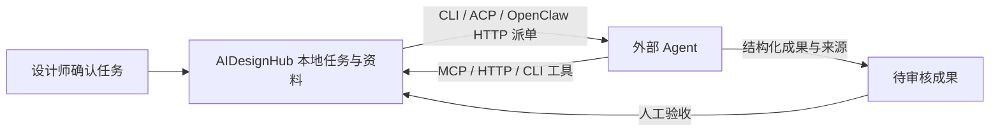

# Agent 协作与案例调研

## 先理解分工

AIDesignHub 负责项目资料、任务、专业 Skill、权限、来源与成果。外部 Agent 负责推理和执行。Hub 没有绑定模型，也不复用某个 Agent 的私有聊天记录作为项目数据库。



MCP 是 Agent 使用 Hub 工具；ACP 是 Hub 作为客户端驱动支持 ACP 的 Agent。它们不是同一个方向。CLI、HTTP 适配和文件任务包是另外三类入口；没有官方自动化接口的软件不能因此被任意接管。

## 使用“Agent 协作”

1. 重启 `D:\AIDesignHUB` 下的桌面程序，进入“Agent 协作”。默认是聊天界面；连接参数与授权不再占据日常工作区。
2. 在输入框下方选择执行 Agent，输入需求后发送。首次发送会确认数据范围与模型调用；尚未配置的执行器可点旁边“配置”。MCP / 人工交接客户端会标注限制，不能伪装成直接聊天入口。
3. 初次接入时打开右上角“设置”→“检测本机执行器”，核对路径并使用配置。协议检查不调用模型；“运行最小测试”才调用模型，最多 60 秒，仅发送固定测试文字，不挂载项目资料。产品预设不等于已经安装或登录。
4. 默认 Skill 是“通用协作”。展开输入框下“任务选项”可更换专业 Skill、明确开放本轮项目只读检索。默认只发送本轮需求、项目基本信息、Skill 与本对话近期历史，不读取其他项目聊天或知识库。外部执行器自身权限不受此开关约束。
5. 进度、真实输出、取消及人工验收直接显示在对话内。每条需求会保存为任务和运行；追问携带同一对话最近 12 条上下文（总计最多 48 KiB，单条最多 16 KiB），过长内容会提示截断。切换 Agent 转发历史前会额外确认；不愿分享历史时点击“新对话”。
6. 正在执行时不能重复发送本会话的新任务，可先写追问。待验收成果允许继续讨论，但不会自动批准旧成果。失败时保留草稿，重复请求不会重复派单；超时、取消或中断不视为成功。
7. “历史记录”可以恢复对话、查看任务及固定输入。原有手动建任务入口收在其中的“高级任务：单独建立派单”。老任务和案例调研记录均保留，不被伪造为新聊天。

模型账号继续在外部 Agent 管理。Hub 不复制模型密钥；HTTP token 只填写环境变量名。手动配置使用真实可执行文件绝对路径与参数数组，不运行 shell 字符串或 Windows 启动 shim。其它兼容工具可使用“自定义 CLI / ACP”，不冒用某个厂商的专用输出解析器。

本轮已在纯临时数据目录，用本机 DeepSeek Harness 实测 ACP 握手、真实短任务和合成建筑任务回传。没有读取真实项目或把测试结果写进正式项目连接。详见 [主动派单实现与验收](outbound-dispatch-2026-10-04.md)。

### 外部 Agent 主动调用 Hub

打开“设置”，展开“高级接入：MCP 与项目授权”，按实际需要开启本地接口，选择项目、成员及最小工具范围，创建授权。原始 token 只在创建时交给用户；Hub 只单独存其哈希，不写入项目备份。不要发到聊天或提交源码。关闭设置、按 Esc、收起 MCP 或离开页面，会清除原始密钥和含密钥模板，迟到的异步结果不能重新显示。清除显示不等于撤销已有授权。

本机工具入口只在需要时监听，应用退出即关闭。手动开启会被记住：下次启动自动恢复到同一端口，已保存的客户端配置无需改动即可继续使用；手动关闭同样会被记住，下次启动保持关闭。派单、项目工具聊天和案例调研引起的临时启动不会写入这个选择，不会让入口在无人操作时长期开放。恢复失败（例如端口被占用）时入口保持关闭并在界面显示可手动开启，不会静默占线。

“连接你的 Agent”列出的是 Hub 能主动派单的方向，不是入站 MCP 的连接状态：外部客户端通过 MCP 读取 Hub 时，不会让它在那个列表里变成已配对。入站连接是否真的生效，看“高级接入：MCP 与项目授权”的授权条目——被调用过的授权会显示调用次数、最近调用时间和工具名，未调用过显示“尚无调用记录”。这里只记录计数、时间与工具名，不保存调用参数或返回内容。

现在可直接在“客户端接入配置”中选择 stdio / HTTP 并生成配置，不必手工拼路径和端口。默认只有密钥占位符；明确勾选“包含本次新授权密钥”才会带入刚创建的授权。复制需要单独点击，不会自动修改 ZCode、ChatGPT 或其它客户端的配置。手动刷新、撤销、隐藏或离开页面会清除原始密钥及含密钥模板，并阻止尚未完成的创建请求再次显示密钥；正常后台状态更新不会清掉仍有效的新密钥。已复制到系统剪贴板的内容不会自动擦除。

ZCode 的“设置 → MCP 服务器 → 新建 → 完整配置”支持粘贴 `mcpServers` JSON；建议逐个添加，勿覆盖已有服务。工作区 `.agents/mcp.json` 可能因已有 `.zcode` 配置被整体跳过，因此本工具不擅自向这些目录写入配置。来源：[ZCode MCP 官方说明](https://zcode.z.ai/cn/docs/mcp-services)。生成模板后仍需在客户端实际连接并调用一个只读工具验收。

默认只读授权适合浏览资料；要认领任务并回传成果，还需明确勾选“认领 / 提交成果”（`runs:write`）。只读 token 不会被自动扩权。

MCP stdio 客户端配置示例（端口和授权 token 必须使用界面实际生成值）：

```json
{
  "mcpServers": {
    "AIDesignHub": {
      "command": "D:\\AIDesignHUB\\.runtime\\electron.exe",
      "args": ["D:\\AIDesignHUB\\scripts\\hub-mcp.cjs"],
      "env": {
        "ELECTRON_RUN_AS_NODE": "1",
        "AIDESIGNHUB_URL": "http://127.0.0.1:<界面端口>",
        "AIDESIGNHUB_TOKEN": "<仅保存在受信任客户端配置中的授权值>"
      }
    }
  }
}
```

HTTP MCP 地址为 `<本地接口地址>/mcp`，Bearer 认证；直接工具调用为 `POST /v1/call`，JSON `{ "name": "hub_task_list", "arguments": {} }`。`scripts/hub-cli.cjs list` 与 `call <工具名> <JSON参数>` 使用同一服务、同一环境授权，不另外打开数据库。

工具包含项目上下文、任务清单、Skill、知识检索、任务创建/开始、运行认领/进度/成果，以及 `hub_case_list`、`hub_case_collect`。工具按授权范围过滤。外部客户端不能验收，也不能通过任务/案例工具启动本机任意命令。

典型外部流程：获取任务 → `hub_run_claim` → 执行并 `hub_run_report` → `hub_artifact_submit`。认领采用租约，避免两个客户端同时回填；长任务应持续报告。授权可撤销，撤销后不能继续读写。

`node scripts/agent-gateway-boot-smoke.cjs` 在隔离数据目录里预置“已开启”状态后启动真实应用，核对入口在同一端口恢复、匿名请求仍被拒、真实 stdio 桥接可完成握手与一次只读调用、该调用出现在授权与界面上，并核对关闭后不会在下次启动重新打开。它不使用真实项目、密钥或模型。

### 各客户端实际边界

| 客户端 | 当前接入路线 | 本机验证状态 |
| --- | --- | --- |
| OpenClaw | MCP 调用 Hub；Hub 用 CLI / 官方 Gateway HTTP 派单 | 2026-10-24 本机 Gateway 恢复，健康检查与一次固定文字真实任务通过；实际案例仍受 Agent 联网工具与来源访问条件影响 |
| Hermes | MCP；CLI；具备 ACP 的版本可配置 ACP | 源码参数已核查；没有验证可执行环境和模型 |
| DeepSeek Harness | ACP；MCP 工具 | 此前已通过真实 ACP 握手、真实短模型任务及合成建筑任务回传；本轮名称案例的真实联网调研待验证 |
| ZCode | MCP 调用 Hub；文件任务包 | 已配置隔离测试入口，真实客户端握手、发现工具、单次只读调用及回答均通过；真实项目和写权限未开放 |
| ChatGPT 桌面 | 取决于账号可用的 MCP/连接器入口；文件任务包 | 未连接用户账户，不承诺直接本地 stdio 或远程控制桌面 |

ChatGPT 官方私有 MCP 路线涉及 Secure MCP Tunnel、开发者模式与相应账户权限，不是把本地端口粘贴进去就完成。没有自动为用户创建隧道、API key 或修改账户配置。参见 [ChatGPT MCP 连接](https://developers.openai.com/plugins/deploy/connect-chatgpt) 与 [Secure MCP Tunnel](https://developers.openai.com/api/docs/guides/secure-mcp-tunnels)。其它客户端具体命令及官方依据见 [兼容说明](agent-compatibility.md)。

### 本机 ZCode 隔离测试入口

本次用户授权添加的服务名是 **AIDesignHub-Test**，位于用户级 `C:\Users\user\.zcode\cli\config.json` 的 `mcp.servers`。该配置可能在不同 ZCode 工作区出现，但无论从哪里调用，都只能访问本次新建的虚构测试项目，不能访问该工作区或正式工作台数据。

已在 ZCode 新建的“AIDesignHub 最小权限连通验收”会话完成真实测试，返回 `AIDesignHub MCP 虚构测试项目` / `project_zcode_mcp_synthetic`。复测提示词：

> 只调用 AIDesignHub-Test 的 hub_project_context 一次，参数为 {}。不要读写文件、不要运行终端、不要调用其他工具。根据真实返回报告项目名称和 ID，并说明这是虚构测试项目。工具不可用时如实说明。

这是连通验收，不是业务任务：只有一个只读工具，没有知识检索、案例采集、任务写入或成果提交。**最小权限指这个 MCP 服务，不代表已限制 ZCode 自身的全部权限。** 测试服务单次最长 30 分钟；到期后需要在 ZCode 重新连接该服务，重连仍然只生成合成数据。无需启动正式 AIDesignHub 窗口，也不会占用正式数据目录。

不用时可在 ZCode 设置中的 MCP 列表停用 `AIDesignHub-Test`；如手工编辑配置，只将该项 `enable` 设为 `false` 或移除该项，勿覆盖其它设置。修改前备份在同目录 `config.aidesignhub-before-20261004-131056.json`，恢复前应先检查是否有后续配置变更。正常断开会撤销临时授权；Windows 强制结束可能无法留下完整清理回执。临时目录中的合成数据和测试回执保留，不自动删除。

## 使用“案例与素材”

### 按项目名称调研

1. 默认选择“按项目名称”。输入项目名称，建议同时给出城市或设计方，例如“上海天文馆 Ennead”。不必先准备网页链接。
2. 选择已配置的主动执行器，再点击“开始联网调研”。此模式需要可实际派单的 CLI / ACP / OpenClaw HTTP；仅配置 MCP 或文件交接不等于 Hub 能主动启动该 Agent。确认框会说明发送的数据及可能消耗的模型额度。
3. 工作台先建立案例卡片和真实任务 / 运行，状态依次显示“Agent 调研中”“正在核对公开来源”“待人工确认”。外部 Agent 搜索、阅读公开页面并回传结构化资料；Hub 独立读取最多 4 个证据网页核对原文。过程与结果都更新在同一张卡片，不另建一张重复成果卡。
4. 只有主来源实际正文能够支持项目名称，才把主来源链接接到案例，并加载原网页项目图片。未找到资料、没有联网工具、来源无法读取、返回格式错误，都会明确显示未完成；不凭模型记忆补造来源。
5. 同名项目无法区分时，右侧预览显示候选项目及来源。补充城市、设计方或更准确的名称后，点击“补充信息并重新调研”；沿用原卡片、递增调研版本，并保留旧运行与历史字段。不会替用户自动挑选一个同名项目。

### 从公开链接采集

现在直接在名称栏粘贴完整 HTTP(S) 链接也会自动切换为链接采集。正文读取后会后台归档图片，Agent 连接失败仍保留已经保存的内容；案例详情中的“查看归档图片”可以恢复正在进行的任务。旧失败卡片中误填的链接可以不选 Agent 重新采集。

“保存整篇文章与全部原图”会保存正文、可获取的图片、尺寸和来源；“导出整篇文章与全部原图”输出正文、原文件和来源清单。微信需要验证时，先在系统浏览器正常打开，另存为“网页，全部”，再导入 HTML，保留旁边同名 `_files` 图片目录。软件不会自动完成验证码，也不把验证页当成文章。单篇 600 个候选、单图 8 MB，缺失、超限和非原图回退会记录；这不是对原站完整性的无限保证。

1. 切换“从链接采集”，粘贴完整公开项目网页链接。原始链接（含查询参数和锚点）原样保存在案例中；页面跳转地址另存，不覆盖原始来源。
2. 选择执行器并“采集并调研”；如只想读取网页，勾选“仅提取页面”。MCP / 文件交接路线会建立待认领或待交接任务，不会自动控制其它软件的聊天窗口。
3. 页面提取不等于 Agent 已调研；没有运行外部 Agent 时，状态仍为“页面已提取 · 待核实”。同一项目内重复提交相同原始链接不会重复建卡或派单。

### 卡片预览、来源与人工确认

点击整张案例卡片或“查看项目”，在工作台右侧展开项目预览；也可通过 Enter / 空格打开、Esc 关闭。卡片显示原网页可用封面与简介；侧栏提供图片切换、网页正文、项目字段、原文摘录、来源和调研状态，“展开阅读”可增大阅读区域。链接和删除按钮不会误触卡片展开。

图片按批读取，首次最多尝试 4 张；有更多图片时可点击“加载更多项目图片”，受总张数和本地容量上限约束。封面缺失、读取失败或旧案例没有链接时显示明确占位说明，不使用示意图冒充项目照片。预览不是完整原站浏览器：动态交互、视频、登录内容及超出限制的部分请通过“原始来源”在系统浏览器查看。“刷新预览”只刷新只读页面缓存，不重新启动 Agent，也不替代调研审核。

字段包括名称、面积 / 规模、类型、区位、开业时间和设计方。缺失信息保留为空，面积保留口径与单位，网页发布时间或竣工日期不能直接代替开业日期。每个字段均可查看证据和来源；来源已读取、引文能够匹配，都不等于设计事实已由人确认。逐项核对后才能“确认入库”，确认后没有找到的字段仍为空。格式错误、身份未确认或来源仍在核验时，不允许绕过案例流程到 Agent 协作中提前验收。

名称与链接调研都不会自动批准成果。正在执行、核验或待审核的任务需先处理，避免重复运行；名称歧义 / 失败的明确重试会退回旧待审核成果并沿用原卡片。更多细节与验收边界见 [名称调研实现记录](case-name-research-2026-10-04.md)。

### 隐私、图片与当前验收边界

Hub 的公开页面与图片读取不携带 Cookie / 登录凭据，不执行网页脚本；逐跳检查 DNS 与目标地址，拒绝内网、云元数据、私有地址和超限内容。403、登录墙、验证码、反爬或纯前端动态页面可能无法提取，不绕过限制。预览仅使用受限的光栅图片数据与纯文本，不把远程网页加载为具有本地接口权限的页面。必要正文、来源和图片预览保存在本地缓存，不代表已离线镜像原站，也不代表获得图片的转载、商用或再发布许可。

名称调研默认不开放 Hub 项目知识库或项目只读 MCP 授权；名称、项目基本信息、专业 Skill、任务指令及公开资料仍可能发送至所选 Agent 和它使用的模型服务。该设置不是外部 Agent 的文件系统沙箱，其自身联网、账户与工具权限必须另行管理。没有读取或改写其它 Agent 私有聊天数据库。

截至本记录：已在隔离临时数据中通过完整 Electron 界面烟测，名称调研覆盖 25 个布尔验收项，使用 3 次模拟 Agent 调用及合成网页；旧聊天、MCP、主动派单和链接案例回归也通过，未记录 renderer errors。这证明工作台流程与接口联动，不证明真实模型已经联网完成案例调研。本轮 DeepSeek Harness 的真实联网案例验证仍待完成；ZCode 仍只确认既有隔离 MCP 只读连通，不因此扩大其能力或权限声明。

## 后台服务与边界

### 任务会话隔离与长输入

每次 Hub 运行生成独立的 `sessionId` 与项目/运行级 `sessionKey`。OpenClaw CLI 配置必须包含 `--session-id {sessionId}`，不能固定复用一个会话；HTTP 使用当前运行的动态 key，`agentId` 可指定目标 Agent（默认 `main`）。ACP 创建新会话。其它自定义 CLI 是否复用外部历史仍由其参数决定：不要配置固定的 resume / session 参数，不能把 Hub 生成新 ID 等同于所有执行器已隔离。

CLI 参数只单次替换 `{prompt}`、`{promptFile}`、`{runId}`、`{projectId}`、`{sessionId}`、`{sessionKey}`。网页或任务正文里出现同名字符串不会被再次解释。OpenClaw 长任务使用 `--message-file {promptFile}`；该文件由 Hub 在本次运行目录中创建，适配器核对内容与本次 prompt 完全一致。Windows 过长 argv 会明确报错，不尝试 shell 绕过。`--deliver` 或收件人参数不会被 Hub 项目任务接受，避免无意向外部聊天发送内容。

`instructions.txt` 保留本次完整任务提示以便追溯，不含临时工具授权；当前不会在任务结束时自动删除。运行目录或配置的 cwd 不是文件系统沙箱，外部 Agent 的工作区及工具权限需在其自身配置中另行限制。

`scripts/hub-service.cjs` 可独立运行，但必须显式设置绝对 `AIDESIGNHUB_DATA_DIR`；同一个目录只能由桌面程序或后台服务其中之一持有写锁。当前桌面 UI 尚不能作为独立客户端附着到已运行的无界面服务。关闭桌面不会替用户自动安装 Windows 服务或常驻守护程序。

数据仍在本地 JSON 持久化，采用原子写入与单写者锁，不宣称已迁移 SQLite。角色化界面不是操作系统沙箱；外部 Agent 自有的工具仍受它自己的权限控制。传给外部 Agent 的资料可能离开本机，使用前应选择项目范围、成员和必要知识授权。
