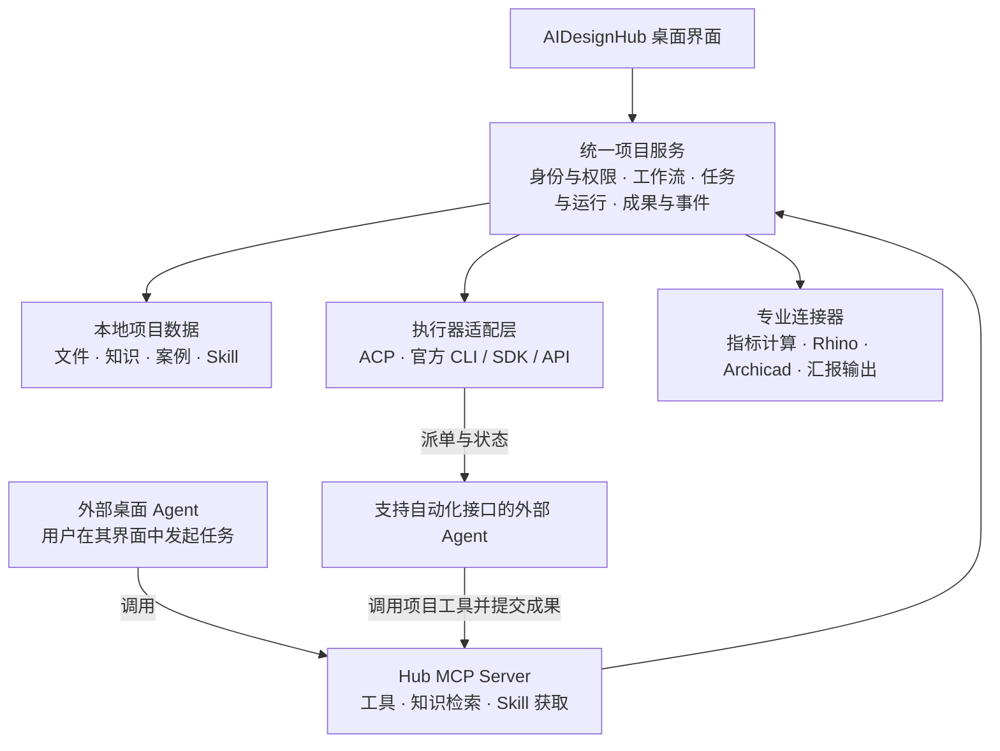

# AIDesignHub 开放 Agent 架构

记录日期：2026-10-04。本文保留最初架构提案；同日后续已实现统一任务核心、Agent 接口与案例链接采集。实际完成范围和验证边界以 [本轮实现记录](agent-case-implementation.md) 为准，不能把下方所有远期设计视为已实现。

本文固定 AIDesignHub 的独立产品边界：工作台管理设计项目、流程、任务、专业知识、Skill、权限和成果；模型推理与 Agent 执行由可替换的外部执行器提供。保留现有桌面界面，允许支持相应协议的外部 Agent 调用工作台，也允许工作台向有自动化接口的 Agent 派发任务。

初次讨论只形成架构文档；随后按用户明确要求在 `D:\AIDesignHUB` 实施。没有修改 BYCJ 生图网站或 Easel，也没有替用户安装或登录外部 Agent。以下目录划分、状态机和存储方案仍含远期设计，需与实现记录对照。

## 产品边界

| AIDesignHub 长期负责 | 外部 Agent 负责 |
| --- | --- |
| 项目档案、成员身份与项目角色 | 在授权范围内理解任务、推理、调用工具 |
| 设计阶段、前置条件、责任人、节点与阶段门 | 根据任务和 Skill 提出执行计划 |
| 任务分配、运行记录、进度、重试与人工审核 | 执行任务并持续报告状态 |
| 本地资料、规范、案例、检索与出处 | 读取获准提供的上下文，生成建议或成果 |
| 专业 Skill 版本、模板、输入输出与验收规则 | 消费兼容的 Skill 指令或工具接口 |
| 指标计算、可确定规则、成果登记与版本 | 调用计算及专业软件连接器 |
| 风险、合同、回款提醒及证据 | 给出可追溯的分析，交由相应人员审核 |

Hub 不要求内置通用 Agent 推理循环，不绑定 OpenClaw、DeepSeek 或某个模型供应商。没有连接 Agent 时，项目管理、资料整理、已有本地检索等功能仍应可用；需要推理的任务明确显示等待执行器。

业务状态以 Hub 保存的记录为准。外部聊天记录可以关联到任务，但不能成为项目进度、审批和成果的唯一存储位置。换 Agent 后可以读取任务快照与既有成果继续工作，不承诺不同软件之间迁移隐藏状态或完整会话语义。

## 两种使用方式

### 外部 Agent 调用 Hub

用户在外部 Agent 中说：“用 AIDesignHub 读取这个项目的任务书，整理缺失资料，建立待确认事项。”

Agent 通过 Hub 的 MCP Server 获取获准访问的项目上下文、专业 Skill、知识检索和任务工具，再把结构化结果写回 Hub。设计师在工作台中查看成果与提醒。这是“外挂工具”的主要使用方式。

MCP 负责暴露工具、资源和提示模板。客户端支持范围不一致，因此关键业务能力必须能通过 tools 使用，不能只放在 resources 或 prompts 中。参见 [MCP 架构](https://modelcontextprotocol.io/docs/learn/architecture)。

### Hub 向 Agent 派发任务

用户在 Hub 的任务卡中选择执行器并点击执行。Hub 经执行器适配层发起任务，接收状态，处理取消和恢复，登记成果。执行器可以通过 MCP 回调 Hub 的业务工具。

本提案中的 ACP 指 Agent Client Protocol。Hub 在此充当 ACP client，连接提供 ACP 服务的 Agent；它不意味着接管已经打开的任意桌面聊天窗口。没有正式派单接口的应用，只提供上面的外部驱动模式，不伪装成可主动派单的执行器。参见 [ACP 架构](https://agentclientprotocol.com/get-started/architecture) 与 [协议概览](https://agentclientprotocol.com/protocol/v1/overview)。



这是目标关系图，不代表这些连接器或协议已经实现。已有 IPC、未来 MCP、API 和 CLI 都调用同一业务服务，不分别维护一套项目规则。

## 初次提案时的代码与目标差距（历史快照）

本节保留实施前的只读审查，**不是当前实现状态**。审查范围为 `D:\AIDesignHUB` 的源码，未读取真实项目数据库、附件或知识资料；后续已完成的接口和测试请看 [实现记录](agent-case-implementation.md)。

| 当前事实 | 源码位置 | 目标改造 |
| --- | --- | --- |
| 已有非 Electron 的 LocalBackend 和 KnowledgeService | `backend/local-backend.cjs:82`、`backend/knowledge.cjs:137` | 保留并明确应用服务边界 |
| 数据为 store.json，全量写入 | `backend/local-backend.cjs:85`、`:115` | 由单个服务统一读写，规划迁移到有事务的本地存储 |
| 渲染界面通过限定的 Electron IPC 调用服务 | `preload.cjs:3` | 保留桌面适配器，增加独立协议适配器 |
| 团队同步 HTTP 使用共享 Bearer 密钥，且移除了知识库字段 | `backend/team-sync.cjs:31`、`:43` | 不直接当作外部 Agent API；新增成员与项目范围授权 |
| 项目 AI 调用本地抽取式检索，没有模型推理 | `app-v2.js:209`、`backend/knowledge.cjs:100` | 检索作为工具，外部 Agent 负责组织答案；另行提升检索质量 |
| 任务已有新增和更新，但没有真正的执行调度 | `backend/local-backend.cjs:169`、`:178` | 增加 Run、审批、产物、依赖与可恢复状态 |
| 流程阶段为前端模板，角色简报为规则筛选 | `app-v2.js:13`、`:50` | 把业务规则迁入服务，界面只负责呈现 |
| 专业软件目前只支持检测与启动 | `electron-main.cjs:117`、`:490` | 按软件正式接口实现具体工具和成果回传 |
| 成员 skills 字段为文本标签 | `backend/local-backend.cjs:197` | 独立的版本化专业 Skill 包 |

初次审查时尚未发现 MCP Server、ACP client、Agent runner、模型 provider 或 Skill loader。当时不能把“项目 AI”界面描述成已完成跨 Agent 编排。后续已实现 MCP、ACP/CLI/HTTP 执行器和版本化 Skill；没有因此内置模型供应商，也没有将所有外部客户端标记为已真实联调。

## 统一任务与执行契约

拟议核心对象为 Project、Member、ProjectRole、Workflow、Task、Run、Approval、Artifact、Evidence、Event、SkillVersion 和 ExecutorConnection。

Task 表示业务目标，Run 表示一次执行尝试。更换 Agent 或重试会新增 Run，而不是覆盖之前的证据。Run 至少包含任务、执行器、输入快照、Skill 版本、权限范围、状态、时间、错误与成果引用；外部 sessionId 仅作映射，不作为业务主键。

拟议运行状态：

```text
queued → running → awaiting_review → succeeded
              ↘ waiting_input
              ↘ failed / cancelled / interrupted
```

状态之间的转移需由服务校验。收到 Agent 的“完成了”只能结束推理回合；完成业务任务还需要输出校验、成果可访问和适用的人工审核。取消也必须区分“已请求取消”和“执行器确认停止”。

多 Agent 并行时，用任务认领租约、版本号、幂等请求和独立运行目录防止重复执行、覆盖与回写冲突。Hub 不能保证外部执行器恰好执行一次，因此产物提交和状态变更必须可幂等重放。断线后核实原任务状态，不能直接重复启动仍在执行的任务。

建议迁移到 SQLite 事务存储，同时保持项目文件和产物为可导出的普通文件。迁移需先备份、校验并保留回退路径。不得让 Electron 与每个 MCP 子进程各自创建后端实例同时写现有 store.json。

## 专业知识和 Skill

专业 Skill 应保存适用阶段、角色、输入要求、步骤、所需工具、输出结构、校验规则及例子。例如任务书研读、用地指标校核、竞品对标、概念汇报、会议纪要提取、变更影响分析和回款节点检查。

Skill 的原始定义与版本由 Hub 管理。兼容客户端可导出对应的 SKILL.md 等包装；其他客户端通过工具获取操作说明和结构化模板。连接 MCP 不等于客户端自动支持所有 Skill 格式或自动遵循全部流程，关键校验仍在服务端完成。

知识检索结果应返回文档身份、版本、页码或定位信息、摘录及来源路径。规范适用范围、失效状态和人工确认应单独记录。向量检索、OCR 或重排可以替换实现，但对外保持稳定检索契约，不能把现有关键词检索称为向量 RAG。

## 接口草案

以下保留初次提案中的候选工具名称，不是当前接口清单。实际工具名称和权限以 `backend/agent-hub.cjs` 的 `TOOL_DEFS` 及 [操作指南](agent-and-case-guide.md) 为准：

| 类别 | 示例工具 | 默认边界 |
| --- | --- | --- |
| 读取上下文 | `hub_project_context`、`hub_task_list` | 仅当前授权项目 |
| 查知识和 Skill | `hub_knowledge_search`、`hub_knowledge_excerpt`、`hub_skill_get` | 分页、限量、来源可追溯 |
| 管理任务 | `hub_task_create`、`hub_task_claim`、`hub_run_report` | 幂等、校验权限和状态 |
| 提交成果 | `hub_artifact_submit`、`hub_review_request` | 受管输出目录、版本化、先提交待审核 |
| 专业操作 | `hub_connector_capabilities`、具体领域工具 | 能力探测及按操作授权 |

不把任意 shell 执行、全磁盘读取、直接 SQL 或任意文件覆盖作为默认开放能力。API 的版本、错误码、分页、任务进度和能力探测统一定义，再映射到不同传输协议。

## 客户端接入核验

以下为 2026-10-04 查阅官方资料所得，不是本机联调结果。各应用实际安装版本、账户能力和权限还需逐个测试。

| 外部应用 | 官方资料支持的结论 | Hub 接入设计 |
| --- | --- | --- |
| DeepSeek Harness | 官方 ACP 包提供自动化会话及 MCP 挂载；该自动化接口不等于交互界面全部能力 | 可评估 ACP 派单及 MCP 工具回调；按实际版本协商能力。来源：[官方 ACP 包](https://github.com/deepseek-ai/deepseek-harness/blob/master/packages/acp/acp/README.md) |
| ZCode | 文档提供外部 MCP 配置，含本地 stdio 与远程 HTTP 等方式 | 优先实现 ZCode 主动调用 Hub；本轮未核实其被 Hub 主动派单的接口。来源：[官方 MCP 文档](https://zcode.z.ai/cn/docs/mcp-services) |
| ChatGPT | 官方提供插件 MCP 接入；私有服务可通过 Secure MCP Tunnel 与开发者模式连接 | 评估官方私有连接方案；账户、工作区权限及桌面端入口须实测，不能假设直接导入本地 stdio 配置。来源：[插件 MCP](https://developers.openai.com/plugins/build/mcp-server)、[Secure MCP Tunnel](https://developers.openai.com/api/docs/guides/secure-mcp-tunnels) |
| 其他 Agent，包括 OpenClaw | 必须核实具体产品版本的正式接口 | 支持 MCP 的可作为工具调用方；有 ACP 或正式 CLI/SDK/API 的再增加派单适配器 |

Hub 中每个连接应明确显示：能否调用工具、能否接受派单、是否支持进度/取消/恢复、可用项目及数据传递范围。不要只用一个“已连接”标记掩盖差异。

## 权限与数据边界

1. 用真实成员身份、客户端授权和项目角色共同确定访问范围。AI 在提示词中自称项目经理不产生管理权限；界面的角色切换也不能代替服务端授权。
2. 读取资料、生成草稿、修改业务状态、运行软件和覆盖成果采用分级能力。设计审批、正式发布、付款确认等仍由有权人员审核。
3. 知识库默认在本机，不代表外部云模型完全不接触数据。提供给外部 Agent 的摘录、图片和工具结果可能上传到其模型服务，应明确提示、允许按项目禁止、按需最小化提供。
4. 资料、网页与导入的 Skill 不能自行扩权。来源内容与控制指令分离，连接器执行独立校验，防止资料中的指令绕过业务权限。
5. 默认只提供本机 IPC/stdio 或受保护的 loopback 服务；远程连接必须另外建立认证和安全传输。私有隧道只是传输方式，不替代工具授权。
6. 外部 Agent 可能另有本机文件、终端或网络权限，Hub 无法仅靠自己的 API 撤销这些权限。隔离要求应落实到执行器配置、允许目录和操作系统执行环境。
7. 日志记录操作者、工具、对象、状态与证据，不记录凭据；可设保留时间。开放协议接口不要求开放源码、网站后台、模型密钥或所有用户资料。

## 桌面应用与本地服务

目标为同一项目服务配合两个入口：可视化桌面界面，以及无界面的受控本地服务。关闭窗口是否保留后台任务、开机是否启动、哪些 Agent 可连接，都必须有可见设置。

推荐独立服务持有数据写入权；Electron 与 MCP bridge 只作为客户端。MCP stdio 进程可以由不同外部 Agent 各自启动，但应连接同一个受认证的项目服务，不能重复开启数据库写入者。具体使用命名管道或 loopback API 由实现阶段验证后决定。

分发必须携带需要的运行时和声明清楚的依赖，不依赖开发机上的兄弟目录缓存。新增本地服务也需进入 Windows 安装、更新、签名、关闭与干净系统测试范围。当前架构记录不代表这些发布条件已经满足。

## 界面如何体现

保留项目驾驶舱、设计流程、项目文件、知识中心、案例素材、专业软件、进度风险、合同回款和团队身份等现有导航。

新增“Agent 连接”设置页；任务卡增加执行器、运行状态、权限、进度、暂停/取消及审核入口；成果页记录由哪个 Agent、哪版 Skill、哪份输入生成，并可查看来源和运行事件。

“询问项目 AI”可按配置调用有派单接口的执行器。只接入外部驱动模式时，界面提供任务上下文与连接说明，不显示虚假的后台执行状态。对各角色的提醒由同一项目事件与权限规则产生，不另建互不一致的项目副本。

## 与自媒体工作台的关系

两者可以共用执行器适配器、任务运行契约、事件日志、权限框架和插件清单等通用包；设计业务保留自己的项目阶段、指标、规范、合同、模型和成果结构，自媒体业务保留选题、素材、渠道与发布结构。

这一共用方案不要求合并两个产品的数据、不要求同一套界面，也不要求安装 OpenClaw。若保留 OpenClaw，只把它作为可选执行器之一。通用模块从真实复用需求提取，避免先引入庞大的跨产品平台依赖。

## 按完整架构分段交付

先固定长期边界，再分段联调；各阶段都沿用同一核心服务和任务契约，不做之后必须推翻的临时版本。

1. 服务层与数据权限：把前端业务规则收拢到核心，建立任务/运行/成果结构、迁移与备份测试。
2. 开放工具面：MCP 项目读取、知识检索、Skill 获取、任务和成果写回。至少两个独立客户端共用同一项目完成任务。
3. 可派单执行器：接入经版本验证的 ACP 执行器，验证进度、断线、取消、恢复、审批与失败重试。
4. 专业能力：逐项实现规范研读、指标、文档生成以及 Rhino/Archicad 连接器，逐项验证产物和副作用。
5. 产品发布：整包依赖、版本升级、数据迁移、日志诊断、签名和干净 Windows 测试。

验收必须包含：卸载一个 Agent 后项目数据仍完整；不打开窗口也能按授权调用；无权角色不能读取或更改受限内容；并发/重试不重复提交；恢复执行有清楚的输入与证据；外部客户端只能获得允许的资料；每个“成功”都有实际成果和校验记录。

上述五阶段属于长期路线，不等于本次全部承诺。初次提案当时尚未实施；截至同日后续开发，独立业务核心、协议入口、执行器及案例链接调研已落地，ZCode 在隔离虚构项目的真实只读调用已通过。当前完整成果与尚未验收项见 [实现记录](agent-case-implementation.md)，不要继续使用本节的历史快照判断现状。真实项目资料、写权限或其它客户端账号的联调仍需按实际授权范围推进。
