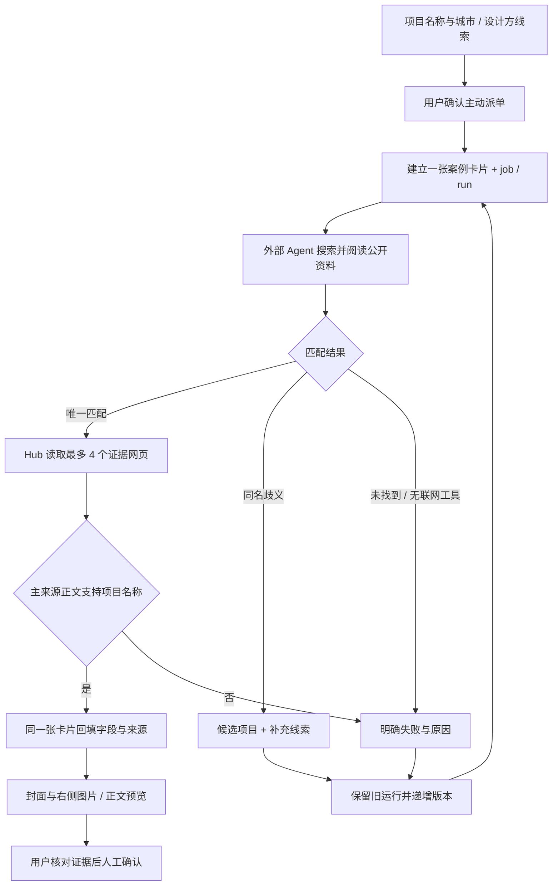

# 按项目名称调研案例：实现与验收记录

记录日期：2026-10-04。范围：AIDesignHub 本地工作台的名称调研、案例回填和预览；不涉及 BYCJ 生图网站改造，也不表示其它桌面 Agent 已获得通用遥控能力。

## 使用目标

用户可以直接输入一个建筑项目名称，并附上城市或设计方，由所选外部 Agent 联网搜索、阅读和整理公开资料。AIDesignHub 负责建任务、保存成果、核对公开来源、更新原案例卡片和提供右侧预览；模型账号和推理执行仍由外部 Agent 管理。

## 入口与执行边界

- 案例采集默认展示名称模式；输入名称即可，不要求先粘贴链接。链接采集和“仅提取页面”继续保留。
- 名称模式需要已配置主动执行入口的 CLI / ACP / OpenClaw HTTP。MCP inbound 或人工文件交接本身不能替代主动执行器。
- 提交会创建真实 Hub 任务和运行，并调用所选执行器；界面不会用前端定时器假装调研完成。
- 同项目内重复的规范化名称查询会返回已有案例，不重复派单；需要重试时应在原卡片操作。
- 本地名称调研请求不会自动向外部客户端开放 Hub 项目资料工具。外部 MCP 客户端不能借名称采集绕过本机主动派单确认。

外部 Agent 的指令要求实际使用联网搜索与网页阅读工具，并回传 `matched`、`ambiguous` 或 `not_found`。这仍依赖执行器确实具备相关能力；单独一次普通模型问答成功，不足以证明联网调研可用。Hub 会独立获取证据网页，但不能仅根据 Agent 自述断言它实际执行过搜索工具。

## 字段与来源核验

结果字段为项目名称、面积 / 规模、项目类型、所在地、开业时间和设计方，并附摘要、主来源、逐字段原文摘录和可选候选项目。

| 状态 / 内容 | 含义 |
| --- | --- |
| `source-quoted` | Hub 实际读取的页面包含对应摘录，且摘录能够支持字段值；不是人工确认 |
| `needs_verification` | Agent 提供了来源或摘录，但未能完成对应原文验证 |
| `unsupported` | 非空字段缺少可用证据 |
| `not_found` / 空值 | 没有找到该信息，不以猜测补齐 |
| `awaiting_review` | 项目主来源身份已通过程序核验，等待用户检查成果 |
| `verified` | 用户明确完成审核；不是 Agent 自行声明的成功 |

Hub 每次独立读取最多 4 个证据网页，超过数量或无法读取的来源仍保留为待核实，不伪装成已读取。主来源实际正文必须支持项目名称，才会把该链接归档为案例主来源并种入预览缓存。面积需要保留口径和单位；发布时间、竣工日期不应被当成开业日期。程序匹配不能取代用户判断来源可信度、同名项目身份及字段口径。

来源核验期间、存在歧义、解析失败或项目身份未确认时，案例页面与 Agent 通用验收入口都不能提前批准。Agent 原成果仍保留，便于检查错误，不因错误而捏造一份看似完整的案例。

## 歧义、失败和重试

歧义结果在右侧显示最多 6 个候选项目，保留安全可打开的来源与区分线索，但不自动合并或选择。用户可在原案例内补充城市、设计方或准确名称，再明确重试。

重试保持案例 ID 不变，递增调研版本；保留旧运行及历史字段、查询、来源和候选。针对歧义或失败的旧待审核成果，明确重试会将其退回，再建立新运行。仍在执行、排队或核验的工作不能被重复启动；正常待审核成果需先处理审核状态。

异步回填核对案例是否仍存在、调研版本、运行 ID、成果 ID 和取消状态。删除案例、切换版本或关闭服务后，迟到的网页响应不能把旧成果重新写回、把已删除案例复活，或把中断任务变为成功。

## 卡片与右侧阅读预览

同一张卡片展示调研状态、真实来源封面和简介。点击卡片可在右侧查看图片、正文、字段证据、候选与原始来源；支持键盘打开、Esc 关闭和焦点恢复。更新数据时保持当前查看的案例，嵌套来源链接或删除按钮不会误触展开。

预览提取公开页面的只读纯文本和光栅图片，不执行远程 HTML / JavaScript。图片首次最多尝试 4 张，可按需分批加载更多；当前最多保留 24 张并受缓存容量约束。正文有长度上限，超限会提示截取。缺图或读取失败有明确说明，不生成图片替代真实项目照片。动态页面、视频、登录内容和其它未提取内容，需打开原始来源查看。

“刷新预览”只更新页面阅读缓存，不等于重跑外部 Agent，也不会自动批准项目字段。旧案例没有原始链接时，既有资料仍保留，界面明确说明无法生成网页预览。

## 隐私和网络限制

名称、项目基本信息、Skill、任务指令和公开网页资料可能发送给外部 Agent 及其模型服务，且可能消耗额度；正式派单前由用户确认。名称调研默认不挂载项目知识库授权，但这不是对外部 Agent 自身能力的沙箱，其账户、文件系统和联网权限仍需在对应产品管理。

Hub 的页面与图片读取不发送登录 Cookie 或私有凭据，拒绝私有地址与危险重定向，并设有大小、数量和超时限制。不会绕过验证码、登录墙或站点反爬。必要来源正文和图片预览缓存在本地，不构成原站完整备份，更不代表获得图片商用、转载或再发布许可。

## 本轮验收记录

已经完成的隔离验证：

- 全套 Node 测试 185 / 185 通过，其中名称调研新增 18 项，成果解析专项 7 项，覆盖真实 job / run 联动、同卡回填、重复请求、来源校验、歧义重试、错误阻断和迟到响应防护。已补日期语义、缺少启动入口、多证据选择及逐版本来源快照测试。
- 完整 Electron 界面烟测通过；名称模式有 25 个布尔验收项，使用 3 次模拟 Agent 调用和合成公开网页，不读取正式项目数据、不实际联网。
- 旧聊天、MCP、主动派单和链接案例的界面回归也通过，未记录 renderer errors。

尚未完成的外部验收：本轮 DeepSeek Harness 的真实联网搜索、网页阅读、案例结构化回传和同卡呈现。此前已验证真实 ACP 握手、真实短模型任务和合成建筑任务回传，但不能将这些结果表述为真实联网案例已成功。ZCode 仅沿用既有隔离 MCP 只读连接结论，其它客户端能力不因本轮实现而扩大。

因此目前可以确认的是工作台的完整名称调研流程与隔离接口验证；不能声称任意项目、任意网站或任意桌面 Agent 都已实测可用。

### 真实联网探针：第一轮

在独立临时项目中使用本机 DeepSeek Harness ACP（0.1.2-rc.1）调研“上海天文馆 Ennead”，实际调用了 `web_search` 与 `web_fetch`，约 75.6 秒返回。部分网页读取失败，执行器继续寻找其它来源。最终返回未通过严格 JSON 解析，探针明确记录 `NON_JSON_RESULT`，没有把它标记为已完成案例，也没有写入真实项目。

回执位于 `C:\Users\user\AppData\Local\Temp\aidesignhub-case-name-probe-A3fXkN\receipt.json`。本轮确认的是实际联网工具被调用，而非整条业务验收成功；未建立 Hub 授权、未启动 Hub Gateway、未读取正式项目，子进程已安全结束。

### 返回解析与字段证据修正

新增有界 JSON 解析：先解析整段 JSON，再兼容前置简短说明后的唯一末尾 JSON 或 JSON 代码块；只使用 JSON.parse，不执行代码、不补括号、不猜字段。多份歧义成果、尾随解释、破损内容仍失败。业务继续验证结构及证据，正常 Hub 运行保留 Agent 原始成果。

第二轮回执 `C:\Users\user\AppData\Local\Temp\aidesignhub-case-name-probe-t1eGEu\receipt.json` 显示实际搜索、阅读和结构化返回成功，Hub 独立读取了建筑师官网、上海政府网页、人民日报三个页面。但 Agent 字段中混入别名、解释及拼接引文，主来源项目名没有通过原文匹配，因此仍明确失败，没有降低校验等级。随后补充字段契约：原语言短值、连续短引文、不加 Markdown 符号、不合并多来源面积，分析和别名进入摘要。搜索组数与详情页数量只作执行器任务约束，不宣称是硬性网络沙箱；Hub 独立核验最多四页是程序边界。
