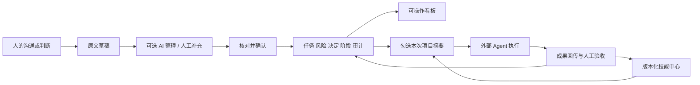

# AIDesignHub 0.2.0：人机协作项目中心

日期：2026-10-04。状态：本地可运行增量版本，不是全套企业系统或正式安装包发布认证。

## 先保存，再改造

仓库：`bycjhuang/AIDesignHub`（私有）。改造前基线提交 `587d6fa`，标签 `baseline-2026-10-04`。基线保留当时源码与草案状态，后续文档勘误不改写基线。

代码与原 BYCJ 生图网站完全分开。Git 排除真实项目数据、附件、知识索引、凭据、运行环境和测试截图。扫描未发现常见令牌/私钥模式，不意味着已完成全面安全认证。

## 核心分工

人决定项目阶段、设计要求、责任与风险。内置 AI 只把文字整理成候选事项。常规程序校验、保存与计算状态。外部 Agent 完成专业任务。Hub 留住项目原文、决定、历史、技能与成果记录。

## 这版如何使用

1. 点“项目助手”，输入电话或会议意见。不勾选 AI 时，仅保存原文；可自行添加任务、风险、待确认要求或阶段变化。
2. 需要 AI 时在“模型设置”填服务地址、模型 ID 和密钥。保存配置不消费额度；勾选“使用内置 AI 整理”后才调用。
3. 核对事项性质、责任人、日期和阶段。重要事项不因模型说“完成”就生效；确认后实际更新原有任务/风险/决定集合，并保存原文和前后值。
4. 推进看板显示同一套记录。阶段与轮次由人设定，任务完成数不等于设计完成度。过期提醒仅根据已登记截止时间计算。
5. 在 Agent 协作“任务选项”中选择技能，按需勾选“携带项目摘要”。发送前会说明交给谁；本次快照固定，项目记录改变时提示旧运行可能使用过时背景。
6. 员工可在技能中心导入 Markdown 或直接写方法，先保存草稿再确认发布；发布不会执行脚本或安装插件。实际终态运行的负责人可评价，作者不得自评。

## 数据与接口

- `backend/project-hub.cjs`：原文草稿、动作白名单、人工确认、乐观版本校验、幂等、原子事务、审计、待同步提醒。
- `backend/model-service.cjs`：DeepSeek、百炼按量、自定义兼容 Chat Completions，超时、响应大小限制、拒绝工具调用与重定向、脱敏错误。
- `backend/skill-center.cjs`：草稿与不可变发布版本，真实运行绑定、评分样本数和贡献统计。
- `backend/agent-hub.cjs`：共享技能目录、任务创建时固定技能版本、显式授权的项目上下文快照、过期提示。
- `store.projectHub`：草稿、审计、提醒；原有 tasks / risks / decisions / projects 是看板唯一业务来源。
- `store.skillCenter`：技能与评价；运行次数从真实 Agent 运行关系计算，不因浏览、上传或发布增加。
- `model-private/model-config.enc`：系统加密配置，不进入业务 `store` 或 JSON 备份；更换 provider/origin 需重新填写密钥。

模型调用只发送当前文字和界面可预览的摘要，不自动遍历文件。摘要采用白名单，并排除已标记敏感、财务角色与部分商务文本；这是辅助筛选，不是可靠的数据防泄漏鉴定。调用前仍需核对，云推理不等于本地推理。

模型协议、来源和套餐限制见 [模型接入说明](model-providers-2026-10-04.md)。自定义兼容不代表任意供应商、推理模式或 API 版本都已实机验证；只实现 Chat Completions 文本整理，不实现 Responses、原生 Anthropic、多模态或工具循环。

## 明确没有冒充完成的部分

- 新提醒仅 `local_pending`，没有远端送达、已读或确认回执。现有群聊局域网同步仍保留，但未扩展为新管理模块的可靠多端同步；连接远端项目的客户端禁止本地确认新管理草稿，避免随后被覆盖。
- 当前成员选择是本机原型身份机制，不是企业登录、岗位强权限或完整审计安全系统；合同独立权限仍待实施。
- 技能发布先限定本机项目级，不是全企业/跨公司商店；文本上传不包含脚本执行能力、插件安装或员工绩效自动评分。
- 文件夹页面仍是只读索引；尚未实现任务级资料勾选、文件版本固定、受控正式归档与目录权限隔离，不会修改用户真实文件。
- 内置助手本轮处理文字，不自动 OCR 截图或解析附件；原有知识导入仍可独立使用。
- 阶段建议检查项不是已通过阶段门。没有交付基线与正式验收记录时不显示总完成度。
- 保留旧原型数据并提示混有预置样例，不批量清空用户案例或知识库。
- 未接入真实模型密钥，因此没有付费模型端到端成功承诺；没有新增签名/干净 Windows 系统发布认证。

## 验收与下一轮

执行 `npm test`：240 项通过，0 失败。包含管理草稿与确认、模型兼容层模拟服务、技能评分、项目上下文与既有 MCP/案例/同步回归。隔离 Electron 烟测通过真实 IPC 检查原文保留、确认写入、幂等、防 XSS、布局、模型未配置、技能选择与原有页面；系统加密存储通过本机加解密回环。测试不读取真实项目数据或调用付费模型。

下一轮优先选一个真实协作场景，接通附件收件/归档与团队分发，再共同确定企业发布审核、岗位权限、技能贡献激励规则。不用增加演示图表替代这些业务闭环。
