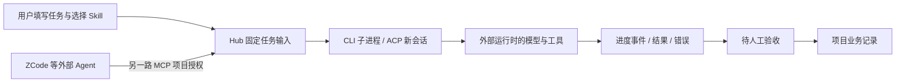

# Hub 主动派单：实现、参考与验收

日期：2026-10-04。目标：从 AIDesignHub 内建立任务并驱动外部 CLI / ACP 运行时，不依赖某个桌面聊天产品，也不把业务状态留在其聊天记录中。

## 现在怎么用

1. 启动 `D:\AIDesignHUB` 的最新 Electron 主进程，打开“Agent 协作”。旧进程不能热更新新增的主进程接口。
2. 点击“检测本机执行器” → 核对路径 → “使用此配置”。发现过程不执行程序、不安装依赖、不读取认证文件。
3. “检查协议 / 配置”确认启动入口或 ACP initialize；“运行最小测试”确认当前模型实际能返回指定文字。两种证据分开显示，不能用握手冒充模型成功。
4. 填写任务、选择专业 Skill 和执行器，点击“建立并派单”。确认发送范围后，Hub 直接启动本次任务。无需到外部聊天窗口再次粘贴指令。
5. 查看执行事件与成果；人工验收之后，关联项目任务才完成。失败可以保留历史并新建执行尝试。

已收集的案例：在案例右侧详情选择已配置的 DeepSeek Harness 等主动执行器，重新调研即可；新案例要取消“仅提取页面”。网页正文和已提取事实成为固定输入，不默认开放全部项目资料。

## 两条路线独立存在

CLI / ACP 是 Hub 主动启动运行时；MCP 是外部 Agent 调用 Hub 工具。ZCode、ChatGPT 桌面卡片没有因此获得未公开的 headless 派单能力。自定义 CLI / ACP 为真正兼容的程序保留入口，不承诺任意 GUI 软件都可调度。

## 本轮实现

- 只读检测 DeepSeek Harness、OpenClaw 的已安装 Node 包与真实入口，Hermes 的 PATH 可执行入口；Windows `.cmd/.ps1` 不直接作为启动目标。
- 连接检查与真实合成测试分离；测试无真实项目输入、无临时项目授权、不创建正式任务。最长 60 秒，失败只显示安全类别。
- 连接修改清除旧验证证据；晚到的旧检查不能把新配置标成成功。应用退出会取消所属检查进程。
- 界面提供“建立并派单”，保留“仅保存任务”，MCP / 人工交接不能误点为主动执行。
- 每次运行保留独立会话、固定输入、Skill 版本、事件与结果。CLI 不经过 shell；ACP 以 `session/prompt` 的 `end_turn` 为完成依据。
- 项目工具默认不挂载。任务级 `allowProjectTools` 只能由本机用户显式选择；授权冻结进输入，不能由外部 MCP 客户端自行扩权。
- 允许项目工具时，只提供有时限的只读工具授权，结束或取消后撤销；不把凭据写进 prompt 或进度日志。
- 对 ACP 额外权限请求默认拒绝；未知反向 RPC 明确返回不支持，避免挂起。没有照搬参考软件的默认全部允许策略。

独立工作目录不是操作系统沙箱，外部运行时仍可能具有其本身的文件、网络和工具能力。涉及修改模型/项目文件的任务需要另做明确权限交互；本轮没有自动放开这些权限。

## 真实执行证据

本机检测：DeepSeek Harness `0.1.2-rc.1`、OpenClaw `2026.9.8`；Hermes 只有参考源码，不把它视为已安装运行时。

首次实际启动 ACP 时，DeepSeek Harness 自行初始化了 `C:\Users\user\.dsh\profiles\acp`，声明其内置 ACP bundle（dependencies 为空）。这是运行时自己的初始化，不是 Hub 复制认证或执行依赖安装；原有 desktop / headless / web profile 未修改，真实 Hub 项目资料未访问。

| 验证 | 结果 | 边界 |
| --- | --- | --- |
| DeepSeek ACP initialize | `ACP_READY` | 未创建模型会话、未发送项目资料 |
| DeepSeek 固定文字测试 | `TASK_READY`，约 2.4 秒 | 实际模型返回 `AIDESIGNHUB_READY`，不是模拟 |
| DeepSeek 合成建筑任务 | 约 3.7 秒，先 `awaiting_review` | 文化建筑 / 合成用地 10000m² / FAR 2.0，返回计容面积 20000m² |
| 对合成结果做字段校验后验收 | `succeeded` | 仅测试项目；正式业务仍由设计师人工审核 |
| 项目授权 | 0 个 | 两次真实模型测试均未挂载项目/知识工具 |

证据目录（保留，未自动清理）：

- `C:\Users\user\AppData\Local\Temp\aidesignhub-live-model-qswKQ1`
- `C:\Users\user\AppData\Local\Temp\aidesignhub-live-acceptance-zOnVO3`

界面烟测使用隔离数据和模拟执行器，验证检测、应用模板、协议状态、测试、直接派单、防重复、默认无项目授权、事件、文本安全显示与人工验收。**这些界面测试不替代上述真实模型证据。** `.smoke-result.json` 是最近一轮运行回执；Node 测试覆盖进程超时、取消、协议错误、权限、授权撤销与连接检查竞态。

最终回归：`node --test tests/*.test.cjs` **151/151 通过**；真实 Electron 隔离界面烟测 `ok: true`，主动派单 13 项断言全部通过，renderer errors 为空。独立审查发现的“协议重检抹掉已通过模型测试状态”已修复并补回归：协议与模型证据分开保留，修改配置才一起失效。

## 四个参考项目取舍

参考源全部独立保存在 `D:\Funny Projects\AIDesignHub-agent-references-2026-10-04`，未放进 AIDesignHub 开发目录、未运行其安装脚本。

| 项目 | 借鉴点 | 本项目不直接照搬 |
| --- | --- | --- |
| [Paperclip](https://docs.paperclip.ing/reference/adapters/overview/) | 分离 `execute` / `testEnvironment`，运行上下文、事件与独立会话 | 不默认放行所有工具，不把适配器列表等同于本机已可用 |
| [AionUi](https://github.com/iOfficeAI/AionUi/wiki/ACP-Setup) / 官方 AionCore | 本机 CLI 检测、Windows 路径处理、ACP 状态与权限事件 | 不重写整个 Hub 为其应用架构，不将客户端界面误当成万能 GUI 驱动 |
| [Mission Control](https://github.com/builderz-labs/mission-control) | 任务派发、运行记录、控制台与成果复核的分工 | 不引入完整服务器管理平台或让 Hub 强依赖 OpenClaw Gateway |
| [CAO](https://github.com/awslabs/cli-agent-orchestrator) | 独立 CLI 会话、协调、任务交接、权限边界警示 | tmux / 类 Unix 依赖不适合直接作为 Windows 桌面底座 |

参考源码的固定 commit、许可证与具体文件位置见参考目录 `REFERENCE-NOTES.md`。本轮独立实现，没有将参考源码直接复制进生产目录。研究得到的是结构与边界，不是“所有桌面 Agent 都自动兼容”的结论。
